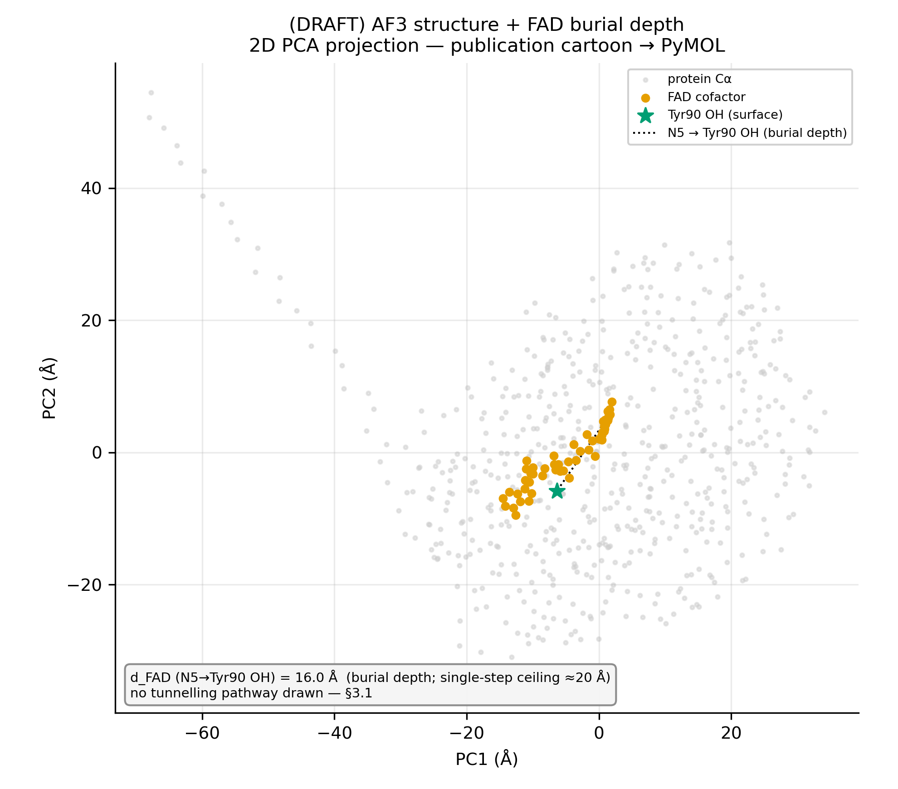
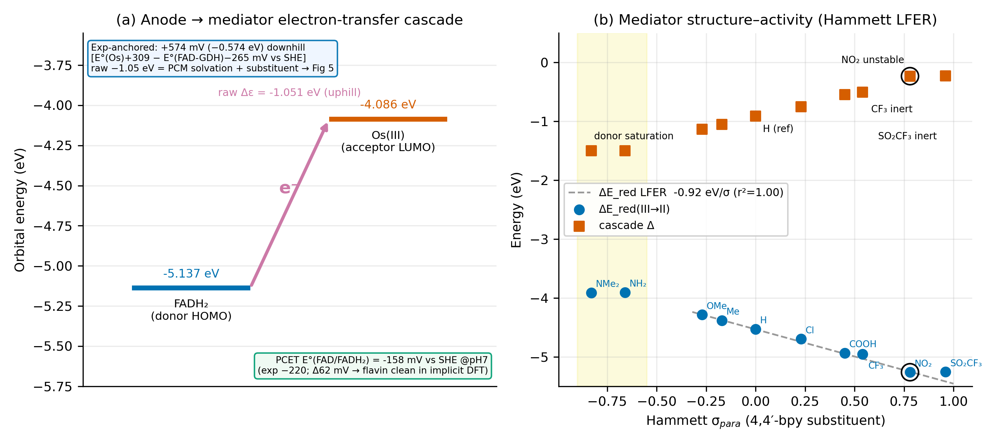
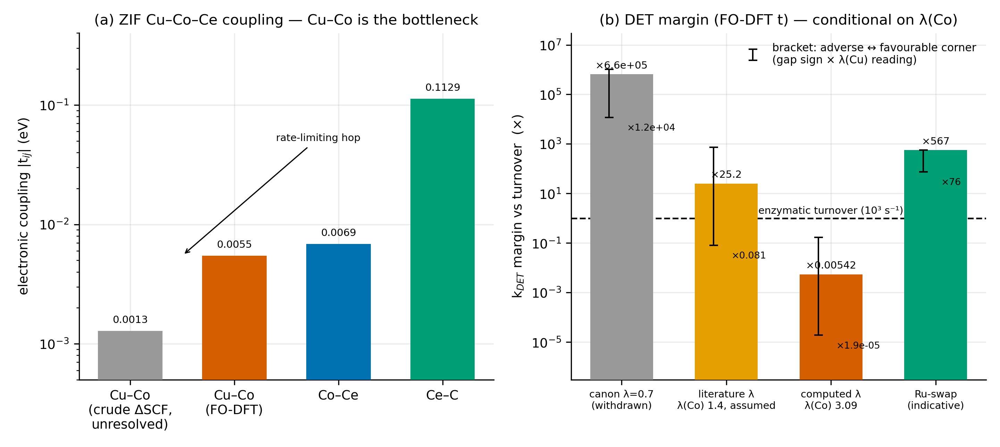
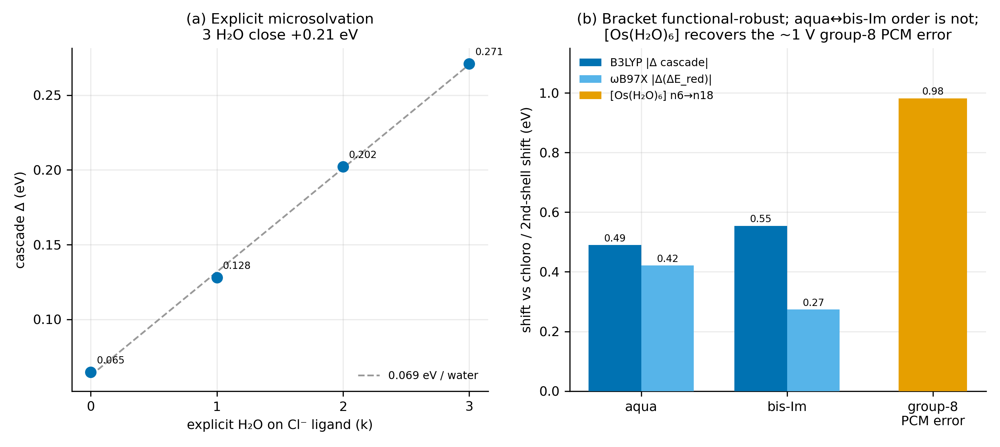
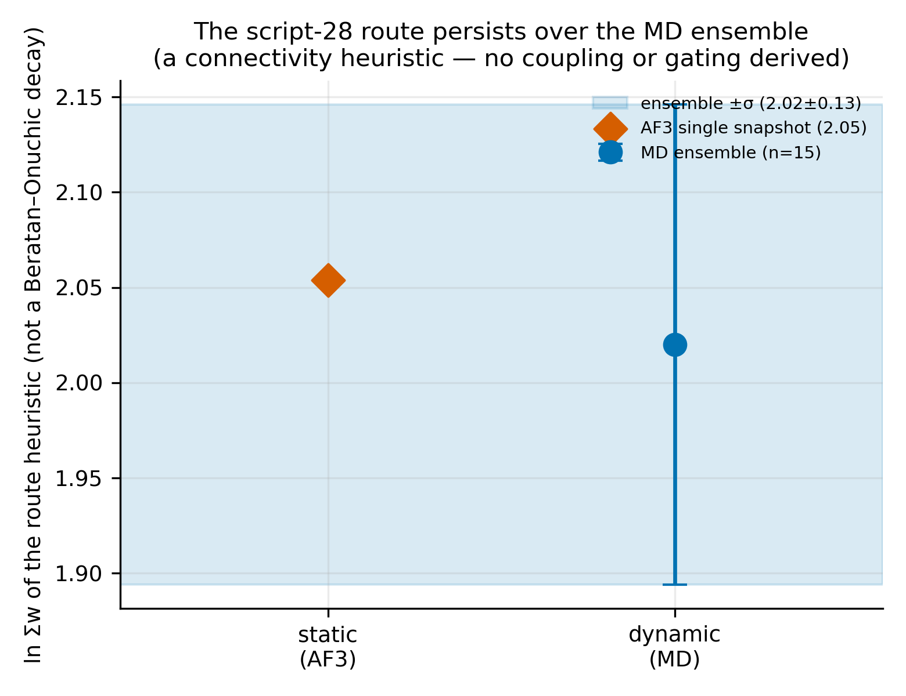

# 3. Results and Discussion — draft (Стаття 1)

> **Draft section** (prose for §3 of [`00_OUTLINE.md`](00_OUTLINE.md)). Numbers are pulled from
> [`SUMMARY.md`](../SUMMARY.md) (One-Home) at draft time — if a value changes, change SUMMARY first,
> then re-pull here. Voice: academic-formal, honest, systems-clear (see
> [`00_WRITING_GUIDE.md`](00_WRITING_GUIDE.md) §Voice). EN (J. Phys. Chem. B). Citations: ACS superscripts →
> [`09_references.md`](09_references.md); `[CITATION NEEDED]` marks a claim with no verified source yet.

We follow the electron from the buried flavin to the external circuit — anode → mediator → cathode —
treating each step as a link whose energetics we can compute and test against experiment.

## 3.1 Architecture and the tunnelling pathway

The AlphaFold 3 model places the FAD N5 atom **16.0 Å** below the protein surface (Tyr90 OH as the
nearest exit). Single-step tunnelling through protein keeps the micro-to-millisecond transfer times a
redox enzyme needs only up to a centre-to-centre distance of ≈20 Å;48 16.0 Å is the burial
depth, not the distance to a docked osmium centre, so it bounds the donor–acceptor separation from below
and distance alone does not settle feasibility. A Beratan–Onuchic pathway analysis identifies a dominant through-bond route, FAD → Ala261 → Thr260 →
Thr288 (PDB residue numbering), with an effective decay **β·d = 2.05** (Fig 2) — feasible for the mediated
transfer the architecture requires. The exit residues are well-ordered in the prediction (pLDDT ≫ 80),
so the path is a structural feature, not a disordered artefact. Replayed over a 15-frame
molecular-dynamics ensemble the decay is essentially unchanged (β·d = 2.02 ± 0.13; conformational-gating
factor 1.03×), confirming that the single-structure pathway is representative of the thermal ensemble
rather than a fortuitous static geometry (Fig S1). The deglycosylated variant modelled here (eleven N→Q
substitutions) preserves this geometry.

## 3.2 Anode PCET: the FAD redox potential

Treating the FAD/FADH₂ couple with a thermodynamic proton reference (rather than an explicit, and in
implicit solvent grossly over-stabilised, hydronium ion) recovers **E°(FAD/FADH₂) = −158 mV vs NHE** —
62 mV positive of the experimental free-flavin value, −220 mV25 (Fig 3a). This is the paper's positive result on the anode side: a
proton-coupled redox potential of a biological cofactor, reproduced by implicit-solvation DFT inside the
±0.15 V uncertainty of the absolute-SHE convention once the proton is handled correctly. It also isolates the cascade discrepancy discussed in §3.5 to the
mediator side of the chain, not the flavin.

The inner-sphere reorganisation energy of the first anode oxidation was likewise computed, not assumed.
The naïve FADH₂/FADH₂•⁺ radical-cation is geometrically pathological in continuum solvent (it
fragments on relaxation); the physically correct, pH-7 first electron transfer is the deprotonated
**FADH⁻ → FADH• + e⁻** couple, whose Nelsen four-point analysis gives an inner-sphere **λ_i = 0.39 eV**.
Adding a Marcus two-sphere outer-sphere term13 gives a total of 0.76–0.86 eV for a
charge-delocalised, buried cofactor; this continuum estimate is, however,
radius- and dielectric-dominated, so we treat it as indicative only. It overlaps the 0.7–0.8 eV range measured for
electron transfer at other protein redox centres (0.7 eV for azurin Cu(II/I), 0.8 eV for the cytochrome
c/b₅ heme pair48), which shows that it is physically reasonable; no rate reported in this work
depends on it.

## 3.3 A structure–activity rule for the osmium mediator

Varying the 4,4′-bipyridine substituents across the experimental potential range gives a clean **Hammett
linear free-energy relationship**: the Os(III/II) reduction energy is linear in σ_para with slope
≈ **−0.92 eV per σ unit** at B3LYP (r² = 1.00; Fig 3b; Table 4). This is a computed trend; it is
not triangulated here against Lever's additive E_L parametrisation,23 but three measured series test it pair
by pair, per 4,4′-substituent so that the reference electrode and the absolute offset cancel. The closest is the series
behind the device mediator itself: the formal potentials of the osmium polymers [Os(4,4′-X₂-bpy)₂(PVI)Cl]⁺ — our core
with the same imidazole N-donor — measured as films in phosphate buffer at pH 7.4 for X = OMe, Me, H and Cl at one Os
loading (polymers synthesised in one route).8 Against it our shifts are 0.87 times the measured for OMe against H (−60.9 against −70.0 mV), 1.34
times for Me (−37.2 against −27.7 mV) and 2.43 times for Cl (+41.9 against +17.2 mV): the measured sensitivity falls
from the donor to the acceptor side (0.422, 0.163 and 0.075 V per σ unit and substituent over the successive pairs)
while ours falls much less (0.236, 0.219 and 0.182). The same complex from another source at another polymer loading
sits 135 mV away — more than replacing all four methyl groups by hydrogen — so the film and its preparation move E°′ by
more than the substituent pairs compared here, and only the equal-loading points of one route are compared. The second series is
the E½(Os III/II) of homoleptic [Os(4,4′-X₂-bpy)₃]²⁺ in acetonitrile for X = H, Me, tBu and OMe, returned by a search
of ChemRxiv.55 Compared per 4,4′-substituent against H —
assuming that the shift is additive across tris and bis complexes, that solvent and charge state move the absolute
potential but not the difference, and that a vertical ΔSCF difference stands for a difference of E½ — OMe agrees
(−60.9 mV computed at B3LYP, −61.7 mV measured) and Me does not (−37.2 mV at B3LYP and −37.3 mV at
ωB97X/def2-TZVP, against −15.0 mV measured). The computed H, Me and OMe lie on one σ_para line on the programmatic
geometry (relaxed, below, Me falls under it too) and the measured do not (r² = 0.82), yet the measured Me is not a lone outlier: the other measured alkyl donor, tBu, is as weak
(−20.0 mV, with its σ_para unchecked and no computed tBu point), so which side carries the difference is not
settled here. Me has little leverage on a donor fit, so a slope through H, Me and OMe restates the OMe pair rather
than adding a second agreement. A third measured series — the E½ of [Os(4,4′-X₂-bpy)₂Cl(ampy)]⁺ (ampy =
4-(aminomethyl)pyridine) in phosphate buffer at pH 7.4 for X = OMe, Me and Cl56 — has our bis-bipyridine
chloro core, formal charge and solvent, so its monodentate N-donor (a pyridine against our 1-methylimidazole) is the
one structural difference, and it has one acceptor. Per substituent, our computed shifts are 0.59 times the measured
for OMe against Me (−23.6 against −39.8 mV), 2.2 times for Cl against Me (+79.1 against +36.3 mV) and 1.35 times for
Cl against OMe (+102.8 against +76.0 mV). The two pairs taken to Me share our Me point, so they are not independent;
the source's own B3LYP, with both oxidation states optimised and the potential taken from free energies, gives 1.01,
1.45 and 1.22 for the same pairs,56 and as its functional is ours, the gap on OMe against Me sits in our
protocol rather than in the functional. Which of the two points carries it this series cannot say, having no H: in
ref 8's series, with our N-donor, it splits about evenly — OMe against H 9.1 mV per substituent short of experiment,
Me against H 9.5 mV over — while in acetonitrile it lies on Me. It is not the osmium basis: replacing LANL2DZ by
def2-TZVP with its core potential moves every point by 62–65 meV and every pair by at most 0.8 mV per substituent.
The ligand basis is bounded on one pair only: on Me against H the range-separated functional at our small basis
moves the shift by +3.2 mV per substituent and def2-TZVP then by −3.3 mV, so our two tiers agree there by
cancellation, and no OMe point exists at the larger basis. Nor is it the continuum's formulation or its radii: on OMe
against Me, where ours falls about 16 mV per substituent short of experiment, the source's formulation
(IEF-PCM)57 in place of C-PCM moves the pair by +0.1 mV and a second set of radii — UFF58 scaled
by 1.1, with a sphere on every hydrogen; the source states none — by −1.1 mV (every pair by at most 0.6 and 4.7 mV).
Removing the continuum moves the pair by −29.0 mV, so the continuum attenuates it, and neither variant moves it by a
tenth of the gap. Nor is it the axial N-donor: pyridine in place of our 1-methylimidazole moves the pair by +0.9 mV,
away from experiment (every pair by at most 3.6 mV). Relaxing the Os(II) geometry of OMe, Me and H with the same
protocol, Os(III) vertical on it (Cl is read below), closes this pair (−18.2 mV, to −41.9 against −39.8 mV per
substituent, 1.05 times; the source's optimised B3LYP gives 1.01) and ref 8's (OMe−Me from 0.56 to 0.99 times), and it
brings ref 8's two pairs against H closer by about 3 mV per substituent each (OMe−H from 0.87 to 1.08 times, Me−H
from 1.34 to 1.23; of the three donor pairs two are independent); Me then falls below the line through H and OMe,
as it does in both measured series that have H (r² of the three computed donors from 0.9996 to 0.957). The
homoleptic acetonitrile series, compared under the transfer assumptions above, moves the other way: OMe against H
goes from 0.99 to 1.23 times the measured. The computed donor pairs change by −9 % (Me−H) to +77 % (OMe−Me), up to
73 meV a complex against the 40–113 meV the points themselves move, so the substituent sensitivity of the vertical
protocol rests on the geometry at the level of the pairs themselves (the pairs with Cl — below). The relaxed
chelate comes closer to the crystal ranges of §2.3 — bite 77.5–78.2° against the programmatic 80.5–80.6°, Os–N(bpy)
2.05–2.09 Å against 2.10 Å — while Os–N(L) lengthens to 2.14 Å and Os–Cl to 2.52–2.53 Å, 0.08–0.09 Å over the
Os(II) range and 0.14–0.15 Å over the Os(III) one, on which Os(III) is computed vertically. Relaxing Os(III) as well,
from each relaxed Os(II) geometry (an adiabatic ΔSCF, with reorganisation energies λ_III of 86–110 meV), moves the two
independent donor pairs toward experiment in both series that have H — OMe−H by +4.2 and Me−H by +6.1 mV per
substituent against Os(III) kept vertical — and their difference, OMe−Me, by −1.9 mV, away from experiment in both
series that measure it. Against the programmatic geometry, Me−H and OMe−Me move toward experiment in every series that
has them, and OMe−H toward ref 8's value and away from the acetonitrile one (from 0.99 to 1.16 times). Ref 8's three
donor pairs then lie within 1.7 mV per substituent of the measured (OMe−H 1.02, Me−H 1.01, OMe−Me 1.04 times), the
acetonitrile Me−H stays 1.86 times the measured, and the aqueous OMe−Me ends at 1.10 times (1.05 with Os(III)
vertical); Me then lies further below the line through H and OMe (r² 0.926). From the programmatic geometry the donor
pairs move by up to 20.1 mV per substituent (80 meV a complex), and on its own minimum Os(III) takes Os–Cl back to
2.42–2.43 Å, 0.04–0.05 Å over its crystal range. With Os(III) on its own minimum the Koopmans cascade Δ of Table 4
moves by −0.142 eV for OMe, −0.070 eV for Me and −0.091 eV for H and stays monotonic in σ_para over the three, while
the ΔE_red slope over the three donors steepens by 13 %, which carried over the σ span of the fit would amount to
≈0.13 eV. The acceptor end of the fit set does not bear that extrapolation out: with NO₂ relaxed in both states as
well, the slope over OMe, Me, H and NO₂ moves from −0.930 to −0.897 eV per σ unit — shallower, 0.034 eV over their
σ span, four of the five fit-set members relaxed (COOH is not). The slope this section sets against ωB97X below,
over Me, H and NO₂ — all three relaxed — moves from −0.931 to −0.859 eV per σ unit, 0.069 eV over their σ span;
ωB97X has no relaxed point, so the ratio of the two slopes below stays one of the programmatic geometry. The closest neighbours of Table 4 are not tested
against the geometry: NMe₂ and NH₂ (1.5 meV apart) are not relaxed, and of NO₂ and SO₂CF₃ (5.0 meV) only NO₂ is (below). Cl, relaxed in both states with
the same protocol (λ_III 94 meV; Os–Cl 2.51 Å on its Os(II) minimum and 2.41 Å on Os(III)'s own, 0.07 and 0.03 Å over
the crystal ranges of §2.3), does not come closer: against the programmatic geometry each of its pairs moves away
from experiment in every series that has it — ref 8's Cl−H from 2.43 to 3.04 times the measured (2.81 with Os(III)
vertical), Cl−Me from 1.76 to 1.79 and Cl−OMe from 1.18 to 1.42 times, the aqueous Cl−Me from 2.18 to 2.22 and Cl−OMe
from 1.35 to 1.63 times (five rows on three computed pairs, which over the donors add one point) — and relaxing Os(III)
after Os(II) brings Cl−Me and Cl−OMe back by only 2.0 and 0.2 mV per substituent. The geometry carries these pairs too
(Cl−OMe moves by 21.4 mV per substituent), but away from experiment and, on the aqueous pairs, away from the source's
own optimised B3LYP (1.45 and 1.22 times the measured), which our relaxation approached on OMe−Me. So where ref 8's
donor pairs come within 1.7 mV per substituent of experiment, the excess on the acceptor side is not an artefact of the
programmatic geometry — our relaxation enlarges it — and what the source's computation has and ours lacks, free
energies among it, is untested on it. Cl's Koopmans cascade Δ moves by −0.066 eV with Os(III) on its own minimum and
by +0.118 eV with Os(III) vertical on the relaxed Os(II). NO₂, relaxed the same way (λ_III 150 meV, the largest of
the five; Os–Cl 2.49 and 2.41 Å on the Os(II) and Os(III) minima, 0.05 and 0.03 Å over the same ranges), has
no measured counterpart in any of the three series, so it adds no pair against experiment and the acceptor-side excess above rests on Cl alone; its cascade Δ moves by
−0.198 eV with Os(III) on its own minimum and by +0.102 eV with Os(III) vertical, 20 to 40 times the 5.0 meV that
separate it from SO₂CF₃ in Table 4, so with SO₂CF₃ not relaxed their order is not decided here, and over the five relaxed members the column stays monotonic
in σ_para on the programmatic geometry and on both relaxed ones (H to Cl 158 meV on the programmatic, 182 meV with both
states relaxed). Left untested are free energies and our
program's own discretisation of the cavity. On its one
acceptor point both computations put the effect above experiment. Its measured shifts fall from the donor to the acceptor side
as ref 8's do (0.397 and 0.091 V per σ unit and substituent), and beyond Cl the acceptor side, most of the σ range of the fit, has no measured counterpart;
the measured shifts are not linear in σ_para, so no slope is read from these three points — where H is measured (two
series), on the programmatic geometry, our Me effect is too large in both and our OMe effect agrees in one and falls
13 % short in the other (Os(II) relaxed, 23 % and 8 % over; both states relaxed, 16 % and 2 % over, with our Me
effect then 1.86 and 1.01 times the measured), and
toward the acceptor end our effect is too large in both series that reach Cl.
A cross-check with the range-separated ωB97X on six of the ten members — the same vertical ΔSCF at
ωB97X/def2-TZVP on the same geometries (Table 4, last column) — keeps the direction and the donor-resonance
plateau of NMe₂/NH₂ but not the magnitude: the ωB97X − B3LYP
difference rises from +0.05 eV at the donor end to +0.26 eV at NO₂, so over the
points of the fit set that both have (Me, H, NO₂) the slope is −0.79 against −0.93 eV per σ unit — a ratio
that rests on the single acceptor point of that set. The second acceptor, SO₂CF₃, lies outside the fit and
carries a smaller difference (+0.18 eV), so the difference is not monotone along σ, and the two acceptors swap
order between the methods (at B3LYP the ΔE_red of SO₂CF₃ is 6 meV less negative than that of NO₂, out of σ order;
at ωB97X it is 72 meV more negative).
Where ωB97X also exists with the smaller basis (§2.2), the change splits. At the centre (Me, H) the
functional alone flattens the local slope by ≈9 % and the larger basis restores it, so the two tiers agree
there by cancellation; over Me, H and NO₂ the slope runs −0.93 (B3LYP) → −0.79 (ωB97X at 6-31G(d)) → −0.79
eV per σ unit (def2-TZVP), so the shallower slope there is the functional's — on a slope that leans on the NO₂
point. The robust content of the rule is
therefore its direction; its slope is method-dependent, the measured Me shift is 1.3 (ref 8) to 2.5 times (acetonitrile,
at both tiers) smaller than ours on the programmatic geometry and 1.0 to 1.9 times with both osmium states relaxed (at
B3LYP), and on the acceptor side, where the rule points, our Cl pairs exceed the
measured ones 1.2 to 2.4 times across the two series that reach Cl on the programmatic geometry and 1.4 to 3.0 times
with both osmium states relaxed, with no measured point beyond Cl.
Electron-withdrawing substituents raise E°(Os) and improve the FADH₂→Os cascade alignment, giving a
predictive design handle rather than a one-off optimisation. E° is not the whole of it: with naphthoquinone mediators
and glucose oxidase or diaphorase immobilised in modified linear-polyethylenimine films, catalytic activity and reversibility differed
between polymer matrices even for mediators of similar redox potential,59 so the rule orders the driving
force but does not by itself set the current.

The rule also exposes a practical subtlety. The maximal cascade driving force is reached by strongly
electron-withdrawing groups, but the strongest (NO₂) is electrochemically **unstable** at the operating
pH (it reduces to the amine on cycling,60 collapsing the cascade to its worst case). Among the inert
high-σ substituents, the cascade Δ of **SO₂CF₃** lies 5 meV above NO₂'s at B3LYP on the programmatic geometry, without the
degradation, and CF₃ is a milder inert alternative. Whether that order survives relaxation is not resolved: relaxing NO₂ alone moves
its own cascade Δ by +0.10 eV with Os(III) vertical and by −0.20 eV on its own minimum (above), twenty to forty times
that gap, and SO₂CF₃ was not relaxed — so it is the strongest inert candidate we computed, not a computed optimum. Crucially, the cascade-thermodynamic
optimum is *not* the cell optimum: a higher E°(Os) lowers the open-circuit voltage, so the experimental
optimum (~+309 mV)8 balances driving force against overpotential.

## 3.4 Direct electron transfer through the ZIF cathode

Inter-metal couplings in the bimetallic Cu–Co–Ce nanozyme were obtained from charge-localised ΔSCF on
clash-free cluster geometries (a bridging imidazole that had collided with the second metal was
deprotonated to the imidazolate, restoring physical coordination). With reorganisation energies
from the two-sphere Nelsen construction rather than assumed — computed for Co, Ce and Ru, while λ(Cu) is
a bracket of two literature readings (2.0 and 2.4 eV, §2.5), a Cu(I) d¹⁰ hexa-aqua optimisation being unphysical, so that λ_hop(Cu–Co) is half
computed and half cited — the **Cu–Co hop is the bottleneck** (Fig 4a; Table 3), and
its rate sits at **~enzymatic turnover** — a margin of order ×1–30 *at zero driving force*, not the orders
of magnitude an earlier (geometry- and λ-) artefact had suggested. That qualifier is load-bearing: the
Marcus rate is exponentially sensitive to ΔG as well as to λ, and the computed **0.183 eV** Cu–Co
site-energy gap (below), carried together with the two λ(Cu) readings, turns the literature-λ figure into a bracket of **×0.0045 to ×40** across the gap's
sign and the readings. At its adverse corner — the uphill gap at the higher λ(Cu) — the cathode is therefore not borderline but rate-limiting, and we quote the
adverse corner throughout. Both λ(Cu) readings are for unconstrained solution couples; a framework-held Cu–N₄
site can lie below both (0.7 eV in azurin48), so the bracket bounds the readings, not the site.

A two-state orbital diabatisation of the metal-d frontier pair (the FO-DFT label of Methods §2.5; no specific published implementation is claimed) confirms the
bottleneck is robust to the coupling method, not an artefact of the crude state-energy ΔSCF: it returns
t_ij(Cu–Co) = 0.0055 eV — within a factor of four of the ΔSCF value, still in the meV regime — together
with a 0.18 eV site-energy gap the crude treatment had assumed away. The resulting margin
straddles turnover in the same way (×0.08 at the adverse corner to ×730 at the favourable one, ×25 at zero
driving force on the 2.0 eV reading), firmly excluding the earlier orders-of-magnitude margin.

This is a finding, not a failure, and we present it with its sensitivity. The rate depends
exponentially on λ: at the assumed first-row literature values (§2.5) and zero driving force the Cu–Co hop sits at
≈ ×1.4 over turnover (Fig 4b); B3LYP over-estimates the first-row λ (the Co couple by ≈ 2×, a spin-crossover artefact),
which would push it lower; and a low-λ metal removes the limitation entirely — replacing Co by **Ru**
(computed λ 0.78 eV vs Co ≈ 3 eV) restores a ×4–31 margin (across the λ(Cu) readings) from the reorganisation energy alone — a
zero-driving-force figure, because the minimal cluster yields no physical Cu–Ru diabatic pair and hence
no site-energy gap for that node. (We also
probed whether Ru's diffuse 4d orbitals additionally raise the coupling: at the fixed cluster geometry
both a crude ΔSCF and an FO-DFT diabatisation returned a large t_ij but failed their physicality check —
the frontier orbitals localise entirely on Ru with no copper partner, so the minimal cluster cannot form
a clean Cu↔Ru diabatic pair; that coupling advantage is therefore a hypothesis for constrained-DFT, not a
result, and the Ru lever is justified here by λ alone.) The honest reading is a cathode that
straddles turnover — rate-limiting at its adverse corner — and whose three design levers — a low-λ metal, conductive-MOF band transport,
or an acid-stable enzyme-free single-atom catalyst — are set out and ranked by their viability at the
acidic Zone 3 (pH ≈ 4.5).

Three model caveats frame this. First, the calculation places the enzyme's electron-entry site
adjacent to the framework node. That adjacency is what an *oriented* immobilisation would deliver — a
His/Cys anchor tethering laccase to the ZIF vertex — and it is an assumption of the model, not an
outcome of it. A randomly adsorbed, arbitrarily oriented laccase does not deliver it: the T1 copper
is held inside the protein by its coordinating residues rather than exposed at the surface (e.g. PDB 1GYC,
a *Trametes versicolor* laccase — an example structure, not a bound for the class), so with the orientational average the donor–acceptor
separation is of order 15–20 Å, and because the coupling decays exponentially with distance, t_ij — and
with it the whole margin reported above — goes to zero. **The margin is therefore conditional on
oriented immobilisation; it is not a property of the nanozyme alone.** Second, the coupling is computed
on a clash-corrected programmatic cluster, not a DFT-relaxed geometry — these flat-PES metal clusters resist geometry optimisation (as the osmium complex
did at the default displacement threshold), so t_ij is geometry-bounded — and we quantify that bound rather than assert it. The bridge ring's
roll about its own N···N axis is a degree of freedom the cluster construction does not fix by energy;
rolling it out of the metals' coordination plane (Cu 0.70 Å, Co 1.37 Å off-plane, everything else held)
raises t_ij 24-fold *and* shrinks the site-energy gap to 0.026 eV, moving the adverse margin from ×0.59
to ×8.9×10³ on the 2.0 eV λ(Cu) reading — i.e. across enzymatic turnover. That configuration is rejected on chemical grounds, since
a coordinating nitrogen binds through a lone pair lying **in** the ring plane and our cluster places the
metals 0.000 Å from it; we report the number because it shows the cathode verdict rests on that single
geometric criterion rather than on a tolerance band, and because the residual spread *within* the
in-plane family (M–N–C angles, in-plane tilt) remains unquantified. Third, the single-hop bottleneck is a conservative estimate: we assume that the Co-noded
framework is a wide-gap insulator — an assumption that errs on the conservative side, since band
conduction, if present, would only add to the hopping we model — so charge transport proceeds by the discrete Marcus hops we model rather than band
conduction, and the 3D framework presents parallel instances of the bottleneck hop — genuine band-like
transport would require a conductive MOF (one of the levers above). A predicted cathode
charge-transfer resistance is correspondingly uncertain: with the DET-rate bracket and the unknown
nanozyme site coverage, a surface-confined (Laviron61) estimate spans ~0.002 Ω to ~30 kΩ — the cathode arc could
be negligible or exceed the anode's by more than two orders of magnitude, so it cannot be fixed a priori, and the kinetic competition
(rather than a single R_ct) is the robust description. The cathode EIS of the forthcoming Ti-coin
experiment is the decisive empirical test.

## 3.5 The cascade and the limits of implicit solvation

The raw computed cascade FADH₂→Os is **unfavourable in every method** (Table 2) — the frontier-orbital alignment
is inverted (a Koopmans HOMO−LUMO offset of −1.05 eV on the real 4,4′-dimethyl-bpy mediator — −1.04 eV under the
conda-lock, §2.7 — the donor level *below* the acceptor) and the adiabatic ΔSCF free energy is uphill (+1.03 eV on the dimethyl mediator, matching the Koopmans offset above and Table 2; +0.88 eV for the plain-bpy parent, the +0.15 eV difference being the substituent term ①) — whereas the **experimentally verified** driving force
is **downhill** (+574 mV, −0.574 eV; from the verified bound FAD-GDH potential, §3.6, and the device osmium-polymer
potential **+309 mV vs NHE** — the best-performing of six polymers wired to GcGDH8). (The orbital offset and the free
energy are distinct quantities, so their signs are not directly comparable; both nonetheless point the "wrong" way
against experiment.) Both stand on the programmatic osmium geometry (§2.3): relaxing both oxidation states of the
dimethyl mediator at B3LYP (§3.3) moves its ΔE_red(III→II) by −0.026 eV (by coincidence the size of closing its
chelates onto the target distances, §2.3) and its Koopmans offset by −0.070 eV (+0.098 eV with Os(III) kept vertical on
the relaxed Os(II)), so at B3LYP neither sign turns (moves under 0.1 eV against offsets of about 1 eV); whether this
holds for the ωB97X/def2-TZVP osmium side of the ΔSCF cascade was not computed. The discrepancy between the ΔSCF free energy and the verified value is the paper's
methodological core, and we decompose rather than excuse it.

The real mediator is the **chloro** complex [Os(4,4′-dimethyl-bpy)₂(PVI)Cl]⁺,8 so the DFT chloro model is
structurally correct and the gap is a **differential-solvation bracket** plus a substituent term (Fig 5).
Differential solvation of the charge-changing octahedral couple is the dominant axis: the as-synthesised **chloro
(+1/+2)** couple closes +0.21 eV with three explicit chloride-shell waters — the **lower bracket**, since the anionic
chloride lowers the couple charge and its continuum error is ≈5× smaller than the benchmark — while in the operating
poly(vinylimidazole) brush the sixth ligand may instead be a second chain imidazole, the PVI-realistic
**bis-imidazole (+2/+3)** form, which closes **+0.55 eV** (the **upper bracket**; aquation is unlikely on the
substitution-inert Os(II) d⁶ couple, so the earlier "the experiment measures the aqua form" framing is withdrawn —
aqua serves only as a methodological benchmark). The [Os(H₂O)₆]³⁺/²⁺ benchmark fixes the +2/+3 scale: adding the
second hydration shell shifts the potential by **+0.98 eV**, reproducing the known ~1 V group-8 implicit-solvation
error.19 A second, smaller axis is the **4,4′-dimethyl substituent** itself (+0.14 eV more uphill than plain bpy — the
donor methyls raise the Os(III) acceptor level, consistent with the Hammett series ①). Crucially, none of these
contributions is tuned to the anchored cascade — the solvation term is benchmarked on a *separate* couple and the
substituent term follows from the structure–activity series — so the discrepancy is decomposed independently rather
than absorbed into a fitted correction. The residual is thus a quantified, transferable limitation of continuum
solvent on charged transition-metal redox couples — not a chemistry problem — whose rigorous closure is
explicit-water QM/MM of the **chloro** species.

## 3.6 The protein environment on the FAD potential

The bound enzyme potential is **E°(FAD-GDH) = −265 mV vs SHE** (an experimentally verified value62); the
protein shifts the cofactor from the free-flavin −220 mV (§3.2) to a more negative −265 mV, i.e. makes FAD a
*better* electron donor and enlarges the cascade driving force — a mechanistic gain, not a gap. An
active-site cluster (isoalloxazine plus the catalytic His537, the charged Glu61 and the backbone amide
contacts within ~5 Å) is defined from the AF3 structure; the rigorous QM-cluster potential, sensitive
to His/Glu protonation, is reserved for the explicit-solvent QM/MM capstone.

## 3.7 Thermal robustness (brief)

Across a molecular-dynamics ensemble the FAD frontier orbital is thermally stable (HOMO −5.59 ± 0.06 eV,
σ ≪ 0.3 eV), so the single-geometry flavin energetics above are representative of the room-temperature
ensemble rather than of one fortuitous snapshot. The ensemble covers the flavin only: the osmium mediator
has no molecular-dynamics treatment here (the force field does not parameterise the metal centre), so its
single fixed geometry (§2.3) is not tested this way.

---

> **Tables T1–T4** (levels of theory · cascade energetics all-methods · DET hops+λ · mediator series)
> are collected in [`06_tables.md`](06_tables.md), generated from the cache by
> [`61_paper_tables.py`](../../../../tools/in_silico/scripts/61_paper_tables.py) (drift-safe, canon-asserted).

## Figures

> Data-driven figures are generated deterministically from the cached DFT results by
> [`tools/in_silico/scripts/60_paper_figures.py`](../../../../tools/in_silico/scripts/60_paper_figures.py)
> (reads `cache/dft/*.json` only — no DFT recompute; every headline number is asserted against
> [`SUMMARY.md`](../SUMMARY.md) at build time). Re-run: `mamba run -n silken_md python tools/in_silico/scripts/60_paper_figures.py`.
> **Fig 2** has a **DRAFT** below (a 2D PCA projection of the AF3 coordinates, generated by the same
> script); a *publication cartoon* still wants PyMOL/ChimeraX on `dgrGcGDH_AF3.pdb`. **Still pending
> (not cache-derivable → illustration pass):** **Fig 1** graphical abstract (cascade over the 3-zone
> gyroid anchor — new art).

**Figure 2 (DRAFT). AF3 architecture and the tunnelling pathway.** 2D PCA projection of the 600-Cα
envelope (grey) with the FAD cofactor (orange) and the Beratan–Onuchic through-bond route
FAD N5 → Ala261 → Thr260 → Thr283 → Thr288 (red); Tyr90 OH marks the nearest surface exit. The flavin
N5 sits **16.0 Å** below the surface — a lower bound on the separation from a docked mediator, against a
≈20 Å single-step ceiling48 — and the through-bond path
(23.7 Å) gives β·d = 2.05. *A 2D projection flattens the burial depth; the publication-grade cartoon
(PyMOL) is the companion to this draft.*

**Figure 3. Anode→mediator electron-transfer energetics.** *(a)* Frontier-orbital cascade for the
rate-determining FADH₂→Os(III) step (B3LYP/6-31G(d)+LANL2DZ(Os)/C-PCM). The raw frontier-orbital offset
is uphill (Δε = −1.05 eV on the dimethyl mediator) and the adiabatic ΔSCF free energy is +1.03 eV on the dimethyl mediator (+0.88 eV plain-bpy reference), whereas the verified driving force is downhill (+574 mV / −0.574 eV, from E°(Os) **+309 mV vs NHE**
[the device 4,4′-dimethyl-bpy Os-PVI polymer8] and the verified bound E°(FAD-GDH) −265 mV vs SHE62); the
raw inversion is the PCM-solvation + 4,4′-dimethyl-substituent artefact decomposed in Fig 5. The
proton-referenced flavin potential, E°(FAD/FADH₂) = −158 mV vs SHE at pH 7, lies 62 mV from
experiment (free flavin −220 mV25). *(b)* Hammett structure–activity relationship for cis-[Os(4,4′-X-bpy)₂(1-MeIm)Cl]⁺/²⁺
at constant charge: ΔE_red(III→II) is linear in σ_para (B3LYP slope −0.92 eV/σ, r² = 1.00; fit over the
OMe→NO₂ regime; the ωB97X cross-check is in Table 4), with donor-resonance saturation at NMe₂/NH₂. Electron-withdrawing substituents raise the
cascade driving force; NO₂ degrades on cycling, and whether the inert SO₂CF₃ (5 meV above NO₂ on the programmatic
geometry) keeps that order on relaxation is not resolved — SO₂CF₃ was not relaxed.

**Figure 4. Direct electron transfer through the bimetallic Cu–Co–Ce ZIF cathode.** *(a)* Inter-metal
electronic couplings |t_ij| (log scale) from charge-localised ΔSCF on clash-free cluster geometries; the
Cu–Co hop is the bottleneck, confirmed by the two-state orbital diabatisation (FO-DFT label, Methods §2.5; 0.0055 eV,
~4× the crude ΔSCF value). *(b)* Marcus k_DET margin of the Cu–Co bottleneck relative to enzymatic
turnover (10³ s⁻¹, dashed) across reorganisation-energy scenarios: bars at ΔG = 0 on the 2.0 eV λ(Cu)
reading (×1.4 at literature λ), whiskers spanning each scenario's adverse and favourable corners over the
sign of the computed site-energy gap and the two λ(Cu) readings — ×0.0045 to ×40 at literature λ — and the
FO-DFT coupling (diamond; ×0.081–732, ×25 at ΔG = 0) brackets the rigorous-coupling result the same way; the earlier ×10⁵ margin (broken geometry
+ assumed λ = 0.7 eV — "canon λ=0.7") is withdrawn. A low-λ metal (Co→Ru, computed λ 0.78 eV) restores a
×4.2–31 margin — a ΔG = 0 figure across the λ(Cu) readings, since the minimal cluster does not yield a physical Cu–Ru diabatic pair and
hence no site-energy gap for that node (§3.4).

**Figure 5. The cascade gap decomposes into a chloro↔bis-Im differential-solvation bracket plus a substituent
term** (the "limits of implicit solvation" result). *(a)* Adding explicit waters to the chloride of the real
(chloro) dimethyl mediator monotonically closes the gap (+0.21 eV / three waters) — the **+1/+2 lower bracket**
(the anionic Cl⁻ lowers the couple charge, so its continuum error is ≈5× smaller than the benchmark). *(b)* In the
operating PVI brush the sixth ligand may be a second chain imidazole — the PVI-realistic **bis-imidazole (+2/+3)
upper bracket** (+0.55 eV vs chloro at B3LYP, +0.27 eV at ωB97X). Both +2/+3 forms (aqua, +0.49 eV, a
methodological benchmark) lie above chloro at **both** functionals — the chloro↔+2/+3 bracket is functional-robust;
only the internal aqua↔bis-Im order is functional-sensitive (B3LYP bis-Im > aqua, ωB97X aqua > bis-Im, ≤0.15 eV). The [Os(H₂O)₆]³⁺/²⁺ benchmark fixes the +2/+3 scale — the second-shell shift
of **+0.98 eV** reproduces the known ~1 V group-8 implicit-solvation error.19

**Figure S1. Thermal robustness of the tunnelling pathway.** The Beratan–Onuchic decay β·d from the
single AlphaFold-3 snapshot (2.05) agrees with the molecular-dynamics ensemble mean (2.02 ± 0.13, n = 15
frames); the conformational-gating factor is a modest ×1.03, so the static-structure pathway is
representative of the thermal ensemble (supports §3.1; the Fig 2 structural render is the companion).
