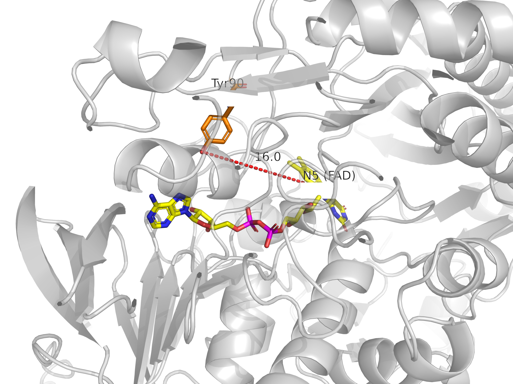
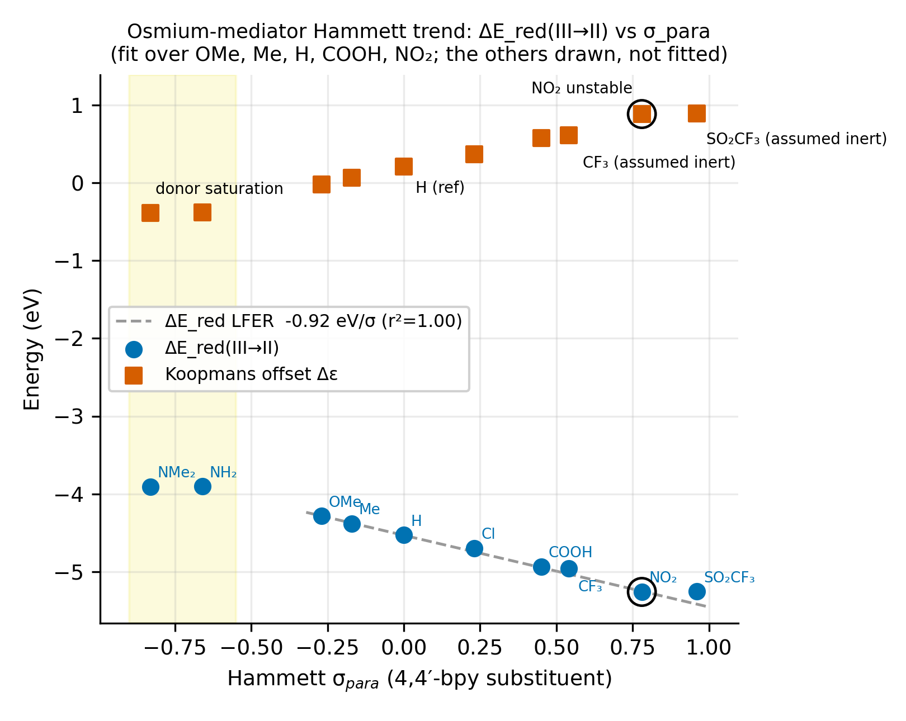
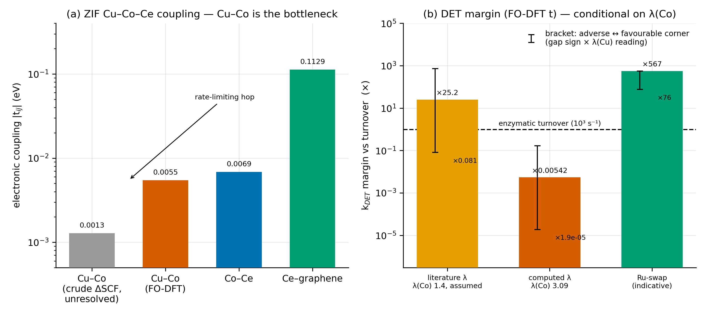
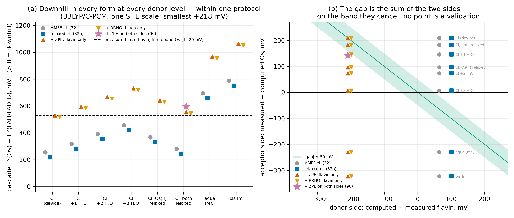

# 3. Results and Discussion — draft (Стаття 1)

> **Draft section** (prose for §3 of [`00_OUTLINE.md`](00_OUTLINE.md)). Numbers are pulled from
> [`SUMMARY.md`](../SUMMARY.md) (One-Home) at draft time — if a value changes, change SUMMARY first,
> then re-pull here. Voice: academic-formal, honest, systems-clear (see
> [`00_WRITING_GUIDE.md`](00_WRITING_GUIDE.md) §Voice). EN (J. Phys. Chem. B). Citations: ACS superscripts →
> [`09_references.md`](09_references.md); `[CITATION NEEDED]` marks a claim with no verified source yet.

We follow the electron from the buried flavin to the external circuit — anode → mediator → cathode —
treating each step as a link whose energetics we can compute and test against experiment.

## 3.1 Architecture and the burial depth of the flavin

The AlphaFold 3 model places the FAD N5 atom **16.0 Å** from the hydroxyl oxygen of Tyr90, the surface atom
chosen as the nearest exit (Fig 1; its 2D projection is Fig S2) — a distance to one chosen atom, read here as the burial depth. Single-step tunnelling through protein keeps the micro-to-millisecond transfer times a
redox enzyme needs only up to a centre-to-centre distance of ≈20 Å;48 16.0 Å is the burial
depth, not the distance to a docked osmium centre, so it bounds the donor–acceptor separation from below
and distance alone does not settle feasibility. The electronic coupling from the flavin to a docked mediator is not
computed here: the contact-graph search we ran (§2.5) neither starts at the isoalloxazine nor weighs its steps as
Beratan–Onuchic decay factors, so no tunnelling pathway is reported; a Beratan–Onuchic analysis from the flavin N5 is
left to follow-up work. The nearest exit, Tyr90, is well-ordered in the prediction (pLDDT ≫ 80). The deglycosylated variant modelled here (eleven N→Q
substitutions) preserves this geometry.

## 3.2 Anode PCET: the FAD redox potential

Treating the FAD/FADH₂ couple with a thermodynamic proton reference (rather than an explicit hydronium ion, which
implicit solvent mis-places by tenths of an eV, §2.4) gives **E°(FAD/FADH₂) = −155 mV vs NHE** at pH 7 on
MMFF94s geometries at the electronic level — 65 mV positive of the experimental free-flavin value, −220 mV25
(Fig S1). That proximity does not survive a thermochemically corrected treatment (Table 2, flavin row): with both flavin states relaxed
(the reduced one a butterfly minimum by its Hessian) the potential moves to −119 mV, and adding the zero-point energy
takes it to −430 mV — the term the electronic level omits while it pairs the flavin with a proton free energy; the reduced
state carries two more N–H bonds, and the change in zero-point energy between the states, +0.62 eV for the two-electron
couple, moves E° by −311 mV; the RRHO free energy gives −419 mV. The thermochemically corrected levels thus lie ≈210 and ≈200 mV more
negative than the measured value. We do not attribute that overshoot — lumiflavin for FAD, the basis and the functional,
the protonation state at pH 7, the harmonic treatment of soft modes, the absolute-SHE convention and the missing explicit
water are all candidates (§3.5) — and read neither level as agreement. The proton reference remains the right frame for the
two-electron, two-proton couple, and it is what makes the like-for-like comparison of §3.5 possible.

The inner-sphere reorganisation energy of the first anode oxidation was likewise computed, not assumed, for
the physically correct, pH-7 first electron transfer — the deprotonated **FADH⁻ → FADH• + e⁻** couple — whose
Nelsen four-point analysis gives an inner-sphere **λ_i = 0.46 eV** (both species minima by their Hessians). The
radical-cation couple FADH₂/FADH₂•⁺ was not used: on the retired 4a,5-dihydro tautomer its cation fragmented on
relaxation in continuum solvent, and on the 1,5-dihydro donor, where it relaxes to a minimum, its λ was not computed.
Adding a Marcus two-sphere outer-sphere term13 gives a total of 0.84–0.93 eV for a
charge-delocalised, buried cofactor; this continuum estimate is, however,
radius- and dielectric-dominated, so we treat it as indicative only. It lies 0.04–0.13 eV above the 0.7–0.8 eV range measured for
electron transfer at other protein redox centres (0.7 eV for azurin Cu(II/I), 0.8 eV for the cytochrome
c/b₅ heme pair48) — the same order, which is all this estimate can show; no rate reported in this work
depends on it.

## 3.3 A Hammett trend for the osmium mediator

Varying the 4,4′-bipyridine substituents across the experimental potential range gives a clean **Hammett
linear free-energy relationship**: the Os(III/II) reduction energy is linear in σ_para with slope
≈ **−0.92 eV per σ unit** per complex at B3LYP (r² = 1.00; Fig 2; Table 4) — four substituents per complex, ≈ 0.23 eV per σ
per substituent, the unit in which the measured series below are read. This is a computed trend; it is
not triangulated here against Lever's additive E_L parametrisation,23 but three measured series test it pair
by pair, per 4,4′-substituent so that the reference electrode and the absolute offset cancel. The closest is the series
behind the device mediator itself: the formal potentials of the osmium polymers [Os(4,4′-X₂-bpy)₂(PVI)Cl]⁺ — our core
with the same imidazole N-donor — measured as films in phosphate buffer at pH 7.4 for X = OMe, Me, H and Cl at one Os
loading (polymers synthesised in one route).8 Against it our shifts are 0.87 times the measured for OMe against H (−60.9 against −70.0 mV), 1.34
times for Me (−37.2 against −27.7 mV) and 2.43 times for Cl (+41.9 against +17.2 mV): the measured sensitivity falls
from the donor to the acceptor side (0.422, 0.163 and 0.075 V per σ unit and substituent over the successive pairs)
while ours falls much less (0.236, 0.219 and 0.182). The same complex from another source at another polymer loading
sits 135 mV away8 — more than replacing all four methyl groups by hydrogen — so the film and its preparation move E°′ by
more than the substituent pairs compared here, and only the equal-loading points of one route are compared. The second series is
the E½(Os III/II) of homoleptic [Os(4,4′-X₂-bpy)₃]²⁺ in acetonitrile for X = H, Me, tBu and OMe, returned by a search
of ChemRxiv.55 Compared per 4,4′-substituent against H —
assuming that the shift is additive across tris and bis complexes, that solvent and charge state move the absolute
potential but not the difference, and that a vertical ΔSCF difference stands for a difference of E½ — OMe agrees
(−60.9 mV computed at B3LYP, −61.7 mV measured) and Me does not (−37.2 mV at B3LYP and −37.3 mV at
ωB97X/def2-TZVP, against −15.0 mV measured). The computed H, Me and OMe lie on one σ_para line on the programmatic
geometry (relaxed, below, Me falls under it too) and the measured do not (r² = 0.82), yet the measured Me is not a lone outlier: the other measured alkyl donor, tBu, is as weak
(−20.0 mV, with its σ_para unchecked and no computed tBu point), so which side carries the difference is not
settled here. Me has little leverage on a donor fit, so a slope through H, Me and OMe restates the OMe pair rather
than adding a second agreement. A third measured series — the E½ of [Os(4,4′-X₂-bpy)₂Cl(ampy)]⁺ (ampy =
4-(aminomethyl)pyridine) in phosphate buffer at pH 7.4 for X = OMe, Me and Cl56 — has our bis-bipyridine
chloro core, formal charge and solvent, so its monodentate N-donor (a pyridine against our 1-methylimidazole) is the
one structural difference, and it has one acceptor. Per substituent, our computed shifts are 0.59 times the measured
for OMe against Me (−23.6 against −39.8 mV), 2.2 times for Cl against Me (+79.1 against +36.3 mV) and 1.35 times for
Cl against OMe (+102.8 against +76.0 mV). The two pairs taken to Me share our Me point, so they are not independent;
the source's own B3LYP, with both oxidation states optimised and the potential taken from free energies, gives 1.01,
1.45 and 1.22 for the same pairs,56 and as its functional is ours, the gap on OMe against Me sits in our
protocol rather than in the functional. Which of the two points carries it this series cannot say, having no H: in
ref 8's series, with our N-donor, it splits about evenly — OMe against H 9.1 mV per substituent short of experiment,
Me against H 9.5 mV over — while in acetonitrile it lies on Me. It is not the osmium basis: replacing LANL2DZ by
def2-TZVP with its core potential moves every point by 62–65 meV and every pair by at most 0.8 mV per substituent.
The ligand basis is bounded on one pair only: on Me against H the range-separated functional at our small basis
moves the shift by +3.2 mV per substituent and def2-TZVP then by −3.3 mV, so our two tiers agree there by
cancellation, and no OMe point exists at the larger basis. Nor is it the continuum's formulation or its radii: on OMe
against Me, where ours falls about 16 mV per substituent short of experiment, the source's formulation
(IEF-PCM)57 in place of C-PCM moves the pair by +0.1 mV and a second set of radii — UFF58 scaled
by 1.1, with a sphere on every hydrogen; the source states none — by −1.1 mV (every pair by at most 0.6 and 4.7 mV).
Removing the continuum moves the pair by −29.0 mV, so the continuum attenuates it, and neither variant moves it by a
tenth of the gap — while the UFF radii move every absolute point by +118 to +137 mV (+122 on the device couple), a shift §3.5
lists among the terms that raise E°(Os). Nor is it the axial N-donor: pyridine in place of our 1-methylimidazole moves the pair by +0.9 mV,
away from experiment (every pair by at most 3.6 mV). Relaxing the Os(II) geometry of OMe, Me and H with the same
protocol, Os(III) vertical on it (Cl is read below), closes this pair (−18.2 mV, to −41.9 against −39.8 mV per
substituent, 1.05 times; the source's optimised B3LYP gives 1.01) and ref 8's (OMe−Me from 0.56 to 0.99 times), and it
brings ref 8's two pairs against H closer by about 3 mV per substituent each (OMe−H from 0.87 to 1.08 times, Me−H
from 1.34 to 1.23; of the three donor pairs two are independent); Me then falls below the line through H and OMe,
as it does in both measured series that have H (r² of the three computed donors from 0.9996 to 0.957). The
homoleptic acetonitrile series, compared under the transfer assumptions above, moves the other way: OMe against H
goes from 0.99 to 1.23 times the measured. The computed donor pairs change by −9 % (Me−H) to +77 % (OMe−Me), up to
73 meV a complex against the 40–113 meV the points themselves move, so the substituent sensitivity of the vertical
protocol rests on the geometry at the level of the pairs themselves (the pairs with Cl — below). The relaxed
chelate comes closer to the crystal ranges of §2.3 — bite 77.5–78.2° against the programmatic 80.5–80.6°, Os–N(bpy)
2.05–2.09 Å against 2.10 Å — while Os–N(L) lengthens to 2.14 Å and Os–Cl to 2.52–2.53 Å, 0.08–0.09 Å over the
Os(II) range and 0.14–0.15 Å over the Os(III) one, on which Os(III) is computed vertically. Relaxing Os(III) as well,
from each relaxed Os(II) geometry (an adiabatic ΔSCF, with reorganisation energies λ_III of 86–110 meV), moves the two
independent donor pairs toward experiment in both series that have H — OMe−H by +4.2 and Me−H by +6.1 mV per
substituent against Os(III) kept vertical — and their difference, OMe−Me, by −1.9 mV, away from experiment in both
series that measure it. Against the programmatic geometry, Me−H and OMe−Me move toward experiment in every series that
has them, and OMe−H toward ref 8's value and away from the acetonitrile one (from 0.99 to 1.16 times). Ref 8's three
donor pairs then lie within 1.7 mV per substituent of the measured (OMe−H 1.02, Me−H 1.01, OMe−Me 1.04 times), the
acetonitrile Me−H stays 1.86 times the measured, and the aqueous OMe−Me ends at 1.10 times (1.05 with Os(III)
vertical); Me then lies further below the line through H and OMe (r² 0.926). From the programmatic geometry the donor
pairs move by up to 20.1 mV per substituent (80 meV a complex), and on its own minimum Os(III) takes Os–Cl back to
2.42–2.43 Å, 0.04–0.05 Å over its crystal range. With Os(III) on its own minimum the Koopmans offset of Table 4
moves by −0.142 eV for OMe, −0.070 eV for Me and −0.091 eV for H and stays monotonic in σ_para over the three, while
the ΔE_red slope over the three donors steepens by 13 %, which carried over the σ span of the fit would amount to
≈0.13 eV. The acceptor end of the fit set does not bear that extrapolation out: with NO₂ relaxed in both states as
well, the slope over OMe, Me, H and NO₂ moves from −0.930 to −0.897 eV per σ unit — shallower, 0.034 eV over their
σ span, four of the five fit-set members relaxed (COOH is not). The slope this section sets against ωB97X below,
over Me, H and NO₂ — all three relaxed — moves from −0.931 to −0.859 eV per σ unit, 0.069 eV over their σ span;
ωB97X has no relaxed point, so the ratio of the two slopes below stays one of the programmatic geometry. The closest neighbours of Table 4 are not tested
against the geometry: NMe₂ and NH₂ (1.5 meV apart) are not relaxed, and of NO₂ and SO₂CF₃ (5.0 meV) only NO₂ is (below). Cl, relaxed in both states with
the same protocol (λ_III 94 meV; Os–Cl 2.51 Å on its Os(II) minimum and 2.41 Å on Os(III)'s own, 0.07 and 0.03 Å over
the crystal ranges of §2.3), does not come closer: against the programmatic geometry each of its pairs moves away
from experiment in every series that has it — ref 8's Cl−H from 2.43 to 3.04 times the measured (2.81 with Os(III)
vertical), Cl−Me from 1.76 to 1.79 and Cl−OMe from 1.18 to 1.42 times, the aqueous Cl−Me from 2.18 to 2.22 and Cl−OMe
from 1.35 to 1.63 times (five rows on three computed pairs, which over the donors add one point) — and relaxing Os(III)
after Os(II) brings Cl−Me and Cl−OMe back by only 2.0 and 0.2 mV per substituent. The geometry carries these pairs too
(Cl−OMe moves by 21.4 mV per substituent), but away from experiment and, on the aqueous pairs, away from the source's
own optimised B3LYP (1.45 and 1.22 times the measured), which our relaxation approached on OMe−Me. So where ref 8's
donor pairs come within 1.7 mV per substituent of experiment, the excess on the acceptor side is not an artefact of the
programmatic geometry — our relaxation enlarges it — and what the source's computation has and ours lacks, free
energies among it, is untested on it. Cl's Koopmans offset moves by −0.066 eV with Os(III) on its own minimum and
by +0.118 eV with Os(III) vertical on the relaxed Os(II). NO₂, relaxed the same way (λ_III 150 meV, the largest of
the five; Os–Cl 2.49 and 2.41 Å on the Os(II) and Os(III) minima, 0.05 and 0.03 Å over the same ranges), has
no measured counterpart in any of the three series, so it adds no pair against experiment and the acceptor-side excess above rests on Cl alone; its Koopmans offset moves by
−0.198 eV with Os(III) on its own minimum and by +0.102 eV with Os(III) vertical, 20 to 40 times the 5.0 meV that
separate it from SO₂CF₃ in Table 4, so with SO₂CF₃ not relaxed their order is not decided here, and over the five relaxed members the column stays monotonic
in σ_para on the programmatic geometry and on both relaxed ones (H to Cl 158 meV on the programmatic, 182 meV with both
states relaxed). Left untested are free energies and our
program's own discretisation of the cavity. On its one
acceptor point both computations put the effect above experiment. Its measured shifts fall from the donor to the acceptor side
as ref 8's do (0.397 and 0.091 V per σ unit and substituent), and beyond Cl the acceptor side, most of the σ range of the fit, has no measured counterpart;
the measured shifts are not linear in σ_para, so no slope is read from these three points — where H is measured (two
series), on the programmatic geometry, our Me effect is too large in both and our OMe effect agrees in one and falls
13 % short in the other (Os(II) relaxed, 23 % and 8 % over; both states relaxed, 16 % and 2 % over, with our Me
effect then 1.86 and 1.01 times the measured), and
toward the acceptor end our effect is too large in both series that reach Cl.
A cross-check with the range-separated ωB97X on six of the ten members — the same vertical ΔSCF at
ωB97X/def2-TZVP on the same geometries (Table 4, last column) — keeps the direction and the donor-resonance
plateau of NMe₂/NH₂ but not the magnitude: the ωB97X − B3LYP
difference rises from +0.05 eV at the donor end to +0.26 eV at NO₂, so over the
points of the fit set that both have (Me, H, NO₂) the slope is −0.79 against −0.93 eV per σ unit — a ratio
that rests on the single acceptor point of that set. The second acceptor, SO₂CF₃, lies outside the fit and
carries a smaller difference (+0.18 eV), so the difference is not monotone along σ, and the two acceptors swap
order between the methods (at B3LYP the ΔE_red of SO₂CF₃ is 6 meV less negative than that of NO₂, out of σ order;
at ωB97X it is 72 meV more negative).
Where ωB97X also exists with the smaller basis (§2.2), the change splits. At the centre (Me, H) the
functional alone flattens the local slope by ≈9 % and the larger basis restores it, so the two tiers agree
there by cancellation; over Me, H and NO₂ the slope runs −0.93 (B3LYP) → −0.79 (ωB97X at 6-31G(d)) → −0.79
eV per σ unit (def2-TZVP), so the shallower slope there is the functional's — on a slope that leans on the NO₂
point. The robust content of the trend is
therefore its direction; its slope is method-dependent, the measured Me shift is 1.3 (ref 8) to 2.5 times (acetonitrile,
at both tiers) smaller than ours on the programmatic geometry and 1.0 to 1.9 times with both osmium states relaxed (at
B3LYP), and on the acceptor side, where the trend points, our Cl pairs exceed the
measured ones 1.2 to 2.4 times across the two series that reach Cl on the programmatic geometry and 1.4 to 3.0 times
with both osmium states relaxed, with no measured point beyond Cl.
Electron-withdrawing substituents raise E°(Os) and improve the FADH₂→Os cascade alignment, giving a
trend that orders the mediators rather than a one-off optimisation. E° is not the whole of it: with naphthoquinone mediators
and glucose oxidase or diaphorase immobilised in modified linear-polyethylenimine films, catalytic activity and reversibility differed
between polymer matrices even for mediators of similar redox potential,59 so the trend orders the driving
force but does not by itself set the current.

The trend also exposes a practical subtlety. The maximal cascade driving force is reached by strongly
electron-withdrawing groups, but the strongest (NO₂) is electrochemically **unstable** when cycled to negative
potentials (grafted films, pH 11: it reduces to the amine,60 taking E°(Os) to the donor end of the series). Among the inert
high-σ substituents, the Koopmans offset of **SO₂CF₃** lies 5 meV above NO₂'s at B3LYP on the programmatic geometry, without the
degradation, and CF₃ is a milder inert alternative. Whether that order survives relaxation is not resolved: relaxing NO₂ alone moves
its own Koopmans offset by +0.10 eV with Os(III) vertical and by −0.20 eV on its own minimum (above), twenty to forty times
that gap, and SO₂CF₃ was not relaxed — so it is the strongest inert candidate we computed, not a computed optimum. Crucially, the cascade-thermodynamic
optimum is *not* the cell optimum: a higher E°(Os) lowers the open-circuit voltage, so the experimental
optimum (~+309 mV)8 balances driving force against overpotential.

## 3.4 Direct electron transfer through the ZIF cathode

Inter-metal couplings in the Co–Cu–Ce nanozyme were computed on clash-free cluster geometries (a
bridging imidazole that had collided with the second metal was deprotonated to the imidazolate, restoring physical
coordination). For the Cu–Co hop — the bottleneck in every live scenario below (Cu–Ru in the Ru swap) — the coupling is a two-state orbital
diabatisation (the FO-DFT label of Methods §2.5; no specific published implementation is claimed):
**t_ij(Cu–Co) = 0.0055 eV**, with a **0.183 eV** site-energy gap. A cruder estimate, half the energy difference of two
SCF solutions of the same cluster (0.0013 eV), is not used: the two solutions were unconstrained, started from the
same guess and differ only in their SCF settings, and their difference is 9.4 times the tolerance both were converged
to, so it does not resolve a coupling (Table 3 prints it beside that ratio; Fig 3a). The other two hops carry that crude
estimate — their differences lie 50 and 830 times above the tolerance, but they are not charge-localised states or a
diabatic coupling either; on those couplings and at zero driving force on those hops (no gap was computed for them)
they are not rate-limiting in any live scenario.

Reorganisation energies come from the two-sphere Nelsen construction — computed for Co, Ce and Ru, while λ(Cu) is a
bracket of two literature readings (2.0 and 2.4 eV, §2.5), a Cu(I) d¹⁰ hexa-aqua optimisation being unphysical, so
λ_hop(Cu–Co) is half computed and half cited. Every margin is a bracket over two axes — the sign of the computed gap,
which the diabatisation does not fix, and the λ(Cu) reading — and we quote its adverse corner. **The cathode verdict
is conditional on λ(Co).** At the computed λ(Co) = 3.09 eV the Cu–Co hop runs at **×1.9×10⁻⁵ to ×0.17** of
enzymatic turnover (×0.0054 at zero driving force): below turnover at every corner — ×0.17 at the kindest, ×1.9×10⁻⁵ at the adverse. At the
literature λ(Co) = 1.4 eV — an assumption, with no primary source in our tree — the bracket is **×0.081 to ×730**
(×25 at zero driving force; Fig 3b): rate-limiting at its adverse corner, above turnover at its favourable one. Reaching
turnover at zero driving force needs **λ(Co) ≲ 2.0 eV** (on the 2.0 eV λ(Cu) reading), and at the adverse corner
**λ(Co) ≲ 0.9 eV**. We have no benchmark that places the computed value above or below the true one: it is the
[Co(NH₃)₆]³⁺/²⁺ couple — an N-donor field, the closer analogue of the ZIF node — with the low-spin Co(III) /
high-spin Co(II) pair imposed, and a spin-state change of that kind carries a large inner-sphere λ. Both λ(Cu)
readings are for unconstrained solution couples; a framework-held Cu–N₄ site can lie below both (0.7 eV in
azurin48), so the bracket bounds the readings, not the site.

This is a finding, not a failure, and we present it with its sensitivity. A low-λ metal removes the dependence on
λ(Co): replacing Co by **Ru** (computed λ 0.78 eV) gives ×76 to ×570 across the λ(Cu) readings — an indicative
figure on three counts: it is a zero-driving-force reading, because the minimal cluster yields no physical Cu–Ru
diabatic pair and hence no site-energy gap for that node; for the same reason it borrows the Cu–Co coupling; and
λ(Ru) sums two Nelsen halves of which one is negative (−0.26 and +1.04 eV), so one of the two optimised geometries is
not the minimum of the state evaluated on it. (We also
probed whether Ru's diffuse 4d orbitals additionally raise the coupling: at the fixed cluster geometry
both a crude ΔSCF and an FO-DFT diabatisation returned a large t_ij but failed their physicality check —
the frontier orbitals localise entirely on Ru with no copper partner, so the minimal cluster cannot form
a clean Cu↔Ru diabatic pair; that coupling advantage is therefore a hypothesis for constrained-DFT, not a
result, and the Ru lever is justified here by λ alone.) The reading supported here is a
cathode whose kinetics are set by λ(Co) — rate-limiting at the computed value, straddling turnover only at the assumed
one — and whose three levers — a low-λ metal (computed indicatively above), conductive-MOF band transport and an
acid-stable enzyme-free single-atom catalyst (named, not computed) — are listed; ranking them for the acidic cathode environment
of the device (xylem sap, pH ≈ 5.75) is left to the experimental programme.

Three model caveats frame this. First, the calculation places the enzyme's electron-entry site
adjacent to the framework node. That adjacency is what an *oriented* immobilisation would deliver — a
His/Cys anchor tethering laccase to the ZIF vertex — and it is an assumption of the model, not an
outcome of it. A randomly adsorbed, arbitrarily oriented laccase does not deliver it: the T1 copper
is held inside the protein by its coordinating residues rather than exposed at the surface (e.g. PDB 1GYC,
a *Trametes versicolor* laccase — an example structure, not a bound for the class), so with the orientational average the donor–acceptor
separation is of order 15–20 Å, and because the coupling decays exponentially with distance, t_ij — and
with it the whole margin reported above — goes to zero. **The margin is therefore conditional on
oriented immobilisation; it is not a property of the nanozyme alone.** Second, the coupling is computed
on a clash-corrected programmatic cluster, not a DFT-relaxed geometry — these flat-PES metal clusters resist geometry optimisation (as the osmium complex
did at the default displacement threshold), so t_ij is geometry-bounded — and we quantify that bound rather than assert it. The bridge ring's
roll about its own N···N axis is a degree of freedom the cluster construction does not fix by energy;
rolling it out of the metals' coordination plane (Cu 0.70 Å, Co 1.37 Å off-plane, everything else held)
raises t_ij 24-fold *and* shrinks the site-energy gap to 0.026 eV, moving the adverse margin from ×0.59
to ×8.9×10³ on the 2.0 eV λ(Cu) reading at the literature λ(Co) — i.e. across enzymatic turnover. That configuration is rejected on chemical grounds, since
a coordinating nitrogen binds through a lone pair lying **in** the ring plane and our cluster places the
metals 0.000 Å from it; we report the number because it shows the cathode verdict rests on that single
geometric criterion rather than on a tolerance band, and because the residual spread *within* the
in-plane family (M–N–C angles, in-plane tilt) remains unquantified. Third, the single-hop bottleneck is a conservative estimate: we assume that the Co-noded
framework is a wide-gap insulator — an assumption that errs on the conservative side, since band
conduction, if present, would only add to the hopping we model — so charge transport proceeds by the discrete Marcus hops we model rather than band
conduction, and the 3D framework presents parallel instances of the bottleneck hop — genuine band-like
transport would require a conductive MOF (one of the levers above). The cathode
charge-transfer resistance is correspondingly bracketed, not predicted: with the DET-rate bracket and the unknown
nanozyme site coverage, a surface-confined (Laviron61) estimate spans ~0.002 Ω to ~7 MΩ — the cathode arc could
be negligible or exceed the anode's by up to five orders of magnitude, so it cannot be fixed a priori — only an arc below ≈ 8 Ω or above ≈ 1.6 kΩ would exclude one λ(Co) branch (§4) — and
the kinetic competition (rather than a single R_ct) is the robust description. The cathode EIS of the forthcoming Ti-coin
experiment is the experimental test.

## 3.5 The cascade like for like

The measured driving force of the anode→mediator step — the two-electron flavin couple against the mediator — is **downhill**: the device osmium polymer sits at
**+309 mV vs NHE** — the best-performing of six polymers wired to GcGDH, measured as a film at pH 7.48 — and the
bound FAD-GDH at −265 mV vs SHE62 (§3.6), a cascade of +574 mV. Against the free flavin (−220 mV at pH 725),
the species we compute, it is +529 mV; the 45 mV between them is the measured protein shift of the bound cofactor, which we
do not compute, while the mediator stays the film-bound one, whose preparation alone moves its E°′ by 135 mV (§3.3).

We compare like with like (Table 2, Fig 4): the two-electron, two-proton FAD/FADH₂ potential at pH 7 (§3.2) against each
one-electron Os(III/II) couple, on one SHE scale and at one tier (B3LYP/6-31G(d), LANL2DZ on Os, C-PCM water; §2.4). Signs: the donor side is the computed
minus the measured flavin potential and the acceptor side the measured minus the computed osmium potential, so each side is
positive where the computed value puts the cascade below the measured one, and the measured minus the computed cascade is
their sum. The
flavin enters at four levels — MMFF geometries, relaxed, + its zero-point energy, + its RRHO free energy — and the osmium
couple in eight forms: the device chloro complex on its programmatic geometry; the same with one to three explicit waters
on the chloride; with Os(II) relaxed and Os(III) kept vertical; with both states relaxed; the bis-imidazole form that the
polymer brush could present (hypothetical, not observed); and the aqua form, a methodological reference only, since aquation is unlikely on
the substitution-inert Os(II) d⁶ couple. The + ZPE and + RRHO levels correct the flavin only, so those cells are one-sided,
except one row in which the osmium side carries its own zero-point energy.

**Direction.** Every cell is downhill; the smallest cascade, +218.5 mV, is the device form on the relaxed electronic
level. That holds within the protocol: every cell shares one functional, one continuum, one absolute-SHE convention
(|SHE_abs| = 4.281 V) and a scalar-relativistic osmium, and varying the flavin level and the osmium form tests none of
them. One term the protocol omits has a known sign: spin–orbit coupling, absent from the LANL2DZ pseudopotential,
stabilises Os(III) and lowers Os(II/III) potentials — by ≈ 300 mV in the abstract of ref 63 (its Table S2 rows run from −152 to −400 mV),19,63 by less
where a lower symmetry quenches it; for [Os(bpy)₃]²⁺/³⁺ itself — homoleptic and D₃, the closest ligand set it treats —
ref 63 computes −250 mV (its Supporting Information, Table S2, CASSCF/CASPT2/CASSI), while the t2g splitting of the C₁
device complex, which sets how far it quenches, is not computed here. A shift beyond the smallest margin, 218.5 mV,
reverses a cell. At the [Os(bpy)₃] value 2 of the 32 cells turn uphill — the device form and the doubly relaxed form,
both on the relaxed electronic flavin level (to −31.5 and −5.0 mV); at the octahedral summary of ref 63's abstract 5 —
the device form on both electronic flavin levels (to −44.8 and −81.5 mV), the doubly relaxed form on both (to −18.3 and
−55.0 mV) and the one-water form on the relaxed level (to −18.1 mV); and at the larger rows of ref 63's Table S2, 7 at −333 mV
([Os(CN)₆]), 8 at −362 mV ([Os(NH₃)₆]) and 10 at −400 mV ([OsCl₆]) — the octahedral summary is not an upper count. Which cells
flip depends as much on the flavin as on the osmium. Every flip sits on the two electronic flavin levels — those that omit
the flavin's zero-point term (§3.2) and lie 65 and 101 mV above the measured flavin potential; the + ZPE and + RRHO cells
keep at least +218.8 mV with the full shift, and the doubly relaxed form with zero-point energies on both sides +296.3 mV.
That margin is, however, largely the ≈ 200 mV by which those levels lie below the measured flavin: against the measured
free flavin the shifted device couple keeps +69.8 mV at the [Os(bpy)₃] value and +19.8 mV at the full one, turning uphill
past −320 mV (−13, −42 and −80 mV at the three larger rows) — less than the two larger alternative choices below move it (159 and
138 mV). With spin–orbit coupling at any of those sizes, the protocol therefore does not determine the sign of the device
cascade: the thermochemically corrected levels keep it downhill only with their donor excess, and without it the margin
lies inside choices the protocol fixes. Three
alternative choices lower E°(Os) relative to ours without being errors of known sign: the other absolute-SHE value in
common use, 4.44 V, lowers every E°(Os) and every cascade by 159 mV when the proton free energy moves with it (E°(Os) has
no proton to compensate) — alone it turns no cell uphill, together with the spin–orbit shift 10 of the 32 at the [Os(bpy)₃] size and 12 at the full one —, and
ωB97X lowers the device couple's E°(Os) by 138 mV (Table 4; 134 mV of it the functional, the rest the basis), with no
ωB97X flavin potential to say what it does to the cascade; def2-TZVP with its core potential on osmium lowers the device
couple's E°(Os) by 65 mV and alone turns no cell uphill. Terms that raise E°(Os) or the cascade are not netted against
these: the osmium zero-point energy (+41 mV where computed, below), the cavity radii (UFF ×1.1 with a sphere on every
hydrogen: +122 mV on the device couple's E°(Os), with no UFF flavin potential; under them the device cell on the relaxed electronic flavin level, −31.5 mV at the [Os(bpy)₃] shift on the default radii, keeps
+91 mV there and +41 mV at −300 mV, so the sign depends on the cavity as well), the explicit waters on the chloride (+63 to +72 mV
each, unconverged — whereas on the small [Os(H₂O)₆]³⁺/²⁺ couple a second shell lowers E° by 0.98 V, ΔE_red going from
−4.946 to −3.964 eV between six and eighteen waters) and, for the device rather than the free couples, the protein shift
of the bound flavin (+45 mV, §3.6). The computed direction therefore agrees with the measured one within the protocol,
and the protocol does not establish it.

**Magnitude.** How far the computed cascade lies from the measured +529 mV, and on which side the difference sits, moves
with the protocol by hundreds of millivolts (Fig 4b). The donor side — computed minus measured flavin — runs +65, +101,
−210 and −199 mV over the four levels; the acceptor side — measured minus computed osmium — runs from +209 mV for the
device chloro form, through +7 mV with three waters on the chloride (one point on an unconverged, near-linear series of
+63, +72 and +67 mV per water, not a closure), to −230 and −324 mV for the aqua and bis-imidazole forms, which lie above
the measured mediator. The absolute-SHE convention moves the split as well: at 4.44 V every acceptor side grows by 159 mV.
We therefore report the magnitude as method-dependent and attribute the gap to neither side.

**Agreements by cancellation.** Where the computed cascade lands within 50 mV of the measured one while each side is at
least 100 mV off — thresholds we set — both sides are large and opposite: the device form at the + ZPE level comes within
1 mV of the rounded +529 mV only because a −210 mV donor deviation and a +209 mV acceptor deviation cancel; the same holds at the RRHO level
(+10 mV) and for the doubly relaxed chloro form at both levels (−27 and −16 mV), all four one-sided cells. None of these is
a validation. That doubly relaxed form is the one with thermochemistry on the osmium side: analytic Hessians of both
relaxed states move its E°(Os) by +41 mV with the zero-point energy (its Os(III) state carries two small imaginary modes, two
methyl torsions, at 22.8i and 14.2i cm⁻¹, both left out of the sums, §2.4), and with zero-point energies
on both sides its cascade reaches +596 mV, 67 mV above the measured value — the remainder of a +142 mV acceptor deviation and
a −210 mV donor deviation, not a near-match. Its RRHO free energy is not compared, because the two osmium states' soft-mode
censuses differ.

**One-electron readings.** The orbital offset and the ΔSCF energies of the single-electron step FADH₂ → FADH₂•⁺ + e⁻, and
the proton-coupled route FADH₂ → FADH• + H⁺ + e⁻ (Table 2b, Table 4), are not like-for-like with a two-electron,
two-proton driving force, and no conclusion is drawn here from their sign. The orbital offset Δε = ε_HOMO(FADH₂) −
ε_LUMO(Os(III)) counts > 0 as downhill, the energy differences per electron > 0 as uphill: on the dimethyl mediator the
B3LYP orbital offset is +0.07 eV on the programmatic osmium geometry, its donor level taken from the planar MMFF geometry of the flavin;
relaxing both oxidation states of the mediator (§3.3) moves its ΔE_red(III→II) by −0.026 eV (by coincidence the size of
closing its chelates onto the target distances, §2.3) and its Koopmans offset by −0.070 eV (+0.098 eV with Os(III) kept vertical on the relaxed Os(II)), so the offset falls to ≈ 0 (−0.003 eV) on Os(III)'s own minimum, inside the 10 meV the
conda-lock moves this LUMO (§2.7). The ωB97X ΔSCF energy (electronic) is +0.39 eV vertical and +0.05 eV with both flavin
states relaxed, and the proton-coupled route +0.61 eV at 1 M H⁺ — +0.20 eV at pH 7 by the Nernst term and −0.125 eV with the flavin
zero-point energies (Table 2b); whether the osmium side of the ΔSCF moves alike on relaxation was not
computed.

**What limits the magnitude.** Neither side is attributed, and the candidate sources are not ranked. On the acceptor
side: the continuum treatment of the charge-changing octahedral couple (each explicit water on the chloride moves
E°(Os) by +63 to +72 mV, the series unconverged; its cavity radii move the device couple's E°(Os) by 122 mV between PySCF's
default set and the UFF set); spin–orbit coupling on osmium (−250 mV as ref 63 computes it for
[Os(bpy)₃], ≈ −300 mV at its octahedral summary and up to −400 mV at the table's other rows, not computed here, which would widen the device form's acceptor side from
+209 to +459 and +509 mV); the
functional (138 mV on the osmium side of the device couple); the osmium geometry (up to 113 mV between the programmatic
and the relaxed forms, Table 2); and the polymer film against one molecule (135 mV between preparations of the measured
complex, §3.3). On the donor side, none of them sized here: lumiflavin for FAD, the basis and the functional, the
protonation state at pH 7, the harmonic treatment of soft modes and the missing explicit water (§3.2). For both: the
absolute-SHE convention (159 mV between 4.281 and 4.44 V). The comparison is made at pH 7 and 7.4, where the two potentials were
measured, not at the sap pH of the device anode (≈ 5.75 for the xylem sap the device runs in, where the proton-referenced flavin
potential of §3.2 would read −81 mV by its −59 mV per pH unit, against −155 mV at pH 7). Explicit-water QM/MM of the chloro species and of the reduced
flavin, spin–orbit coupling on osmium and a model of the film are each a step toward the magnitude; the first is the
named limit of this paper.

## 3.6 The protein environment on the FAD potential

The bound enzyme potential is **E°(FAD-GDH) = −265 mV vs SHE** (a measured value62); the
protein shifts the cofactor from the free-flavin −220 mV (§3.2) to a more negative −265 mV, i.e. makes FAD a
*better* electron donor and enlarges the cascade driving force — a mechanistic gain, not a gap. An
active-site cluster (isoalloxazine plus the catalytic His537, the charged Glu61 and the backbone amide
contacts within ~5 Å) is defined from the AF3 structure; the rigorous QM-cluster potential, sensitive
to His/Glu protonation, is reserved for the explicit-solvent QM/MM capstone.

## 3.7 Thermal robustness (brief)

The flavin energetics above are single-geometry, and their thermal robustness is not established here: the fragment script 27 cuts from the trajectory is not the closed isoalloxazine ring — its HOMO–LUMO gaps of 0.14–0.24 eV, against ≈ 3.4 eV for lumiflavin at B3LYP/6-31G(d) in C-PCM (script 20; the fragments were computed in the gas phase), are those of broken bonds — and three of its five snapshots are the same frame (4.9 ns; the 6, 8 and 10 ns targets lie beyond the trajectory).
No frontier-orbital spread over a molecular-dynamics ensemble is therefore reported. The osmium mediator
has no molecular-dynamics treatment here (the force field does not parameterise the metal centre), so its
single fixed geometry (§2.3) is not tested this way.

---

> **Tables T1–T4** (levels of theory · the cascade like for like and its one-electron readings · DET hops+λ · mediator series)
> are collected in [`06_tables.md`](06_tables.md), generated from the cache by
> [`61_paper_tables.py`](../../../../tools/in_silico/scripts/61_paper_tables.py) (drift-safe, canon-asserted).

## Figures

> Data-driven figures are generated deterministically from the cached DFT results by
> [`tools/in_silico/scripts/60_paper_figures.py`](../../../../tools/in_silico/scripts/60_paper_figures.py)
> (reads `cache/dft/*.json` only — no DFT recompute; every headline number is asserted against
> [`SUMMARY.md`](../SUMMARY.md) at build time). Re-run: `mamba run -n silken_md python tools/in_silico/scripts/60_paper_figures.py`.
> **Fig 1** is the PyMOL render of `dgrGcGDH_AF3.pdb` (`fig1_pymol_cartoon.py`, run outside the recorded environment); its 2D PCA
> companion is Fig S2 (Supporting Information, drawn by `60`), and the frontier-orbital levels are Fig S1. The journal TOC graphic
> (`figures/toc_graphic_draft.png`, the cascade over the 3-zone anchor) is not a numbered figure and is still a draft.

**Figure 1. AF3 architecture and the burial depth of the flavin.** Cartoon of the aglycosylated FAD-GDH model (grey) with the FAD cofactor (sticks, carbon in yellow, phosphorus in magenta; N5 labelled) and Tyr90 (orange, labelled); the red dashed line, labelled with its length, is the **16.0 Å** distance from N5 to the hydroxyl oxygen of Tyr90, the surface atom chosen as the nearest exit — read as the burial depth, a lower bound on the separation from a docked mediator, against a ≈20 Å single-step ceiling.48 No tunnelling pathway is drawn (§3.1). *A 2D PCA projection of the same model is Fig S2.*

**Figure 2. The osmium-mediator Hammett trend.** ΔE_red(III→II) of cis-[Os(4,4′-X-bpy)₂(1-MeIm)Cl]⁺/²⁺ at constant charge against σ_para (B3LYP/6-31G(d)+LANL2DZ(Os)/C-PCM; slope −0.92 eV per σ unit per complex, r² = 1.00, fitted over OMe, Me, H, COOH and NO₂ — Cl, CF₃, SO₂CF₃, NMe₂ and NH₂ are drawn but not fitted, §3.3; the ωB97X cross-check is in Table 4), with donor-resonance saturation at NMe₂/NH₂ (shaded band); the squares are the Koopmans offsets of the same complexes, a one-electron reading, and the open rings mark NO₂, which degrades on cycling. Electron-withdrawing substituents raise E°(Os), which enters the like-for-like cascade one for one; NO₂ degrades on cycling, and whether SO₂CF₃ (taken as electrochemically inert; 5 meV above NO₂ on the programmatic geometry) keeps that order on relaxation is not resolved — SO₂CF₃ was not relaxed. The frontier-orbital levels of the anode→mediator step are Fig S1.

**Figure 3. Direct electron transfer through the Co–Cu–Ce ZIF cathode.** *(a)* Inter-metal
electronic couplings |t_ij| (log scale) on clash-free cluster geometries: for Cu–Co, the two-state orbital
diabatisation the margins use (FO-DFT label, Methods §2.5; 0.0055 eV) beside the crude two-solution ΔSCF estimate
(0.0013 eV), which its SCF tolerance does not resolve; the other two hops carry the crude estimate. *(b)* Marcus k_DET
margin of the Cu–Co bottleneck relative to enzymatic turnover (10³ s⁻¹, dashed) on the diabatised coupling, across
reorganisation-energy scenarios: bars at ΔG = 0 on the 2.0 eV λ(Cu) reading, whiskers spanning each scenario's adverse
and favourable corners over the sign of the computed site-energy gap and the two λ(Cu) readings — ×0.081 to ×730 at
the assumed literature λ(Co) of 1.4 eV, ×1.9×10⁻⁵ to ×0.17 at the computed λ(Co) of 3.09 eV. A low-λ metal (Co→Ru, computed λ 0.78 eV) reads
×76–570 — indicative: a ΔG = 0 figure on the borrowed Cu–Co coupling, with one negative Nelsen half in its λ (§3.4).

**Figure 4. The cascade like for like.** *(a)* The cascade E°(Os) − E°(FAD/FADH₂, pH 7) for each osmium form
(B3LYP/6-31G(d)+LANL2DZ(Os)/C-PCM, one SHE scale) at the four levels of the flavin — MMFF electronic, relaxed electronic,
+ zero-point energy and + RRHO free energy, the last two correcting the flavin only — and, for the doubly relaxed chloro
form, with the zero-point energy on both sides (star); dashed, the measured +529 mV (free flavin; film-bound mediator).
Every point is downhill within this protocol, which omits spin–orbit coupling on osmium (−250 mV for [Os(bpy)₃] in ref 63,
≈ −300 mV in its abstract and up to −400 mV at the other rows of its Table S2; at any of them the protocol does not determine the sign of the device cascade, §3.5); how far a point lies from the measured value depends on the protocol. *(b)* The same points as their donor side (computed − measured flavin) and acceptor side (measured −
computed osmium): the gap is their sum, so a point on the shaded band (|gap| ≤ 50 mV) with both sides at least 100 mV off
— thresholds we set — is two large deviations cancelling, as for the device form at the + ZPE level (within 1 mV, from −210 and
+209 mV); none is a validation.
